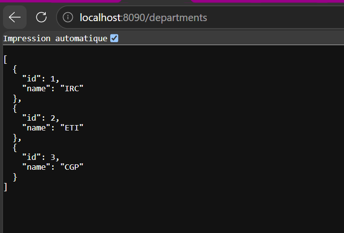
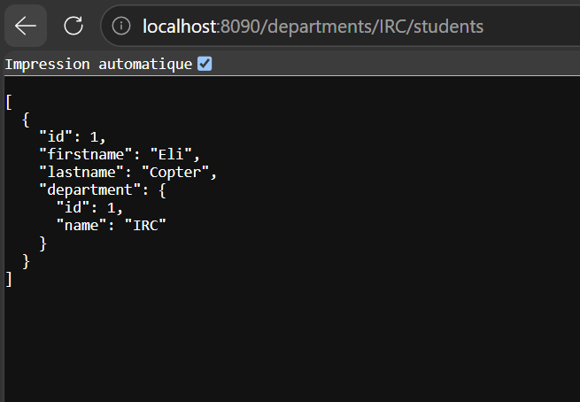
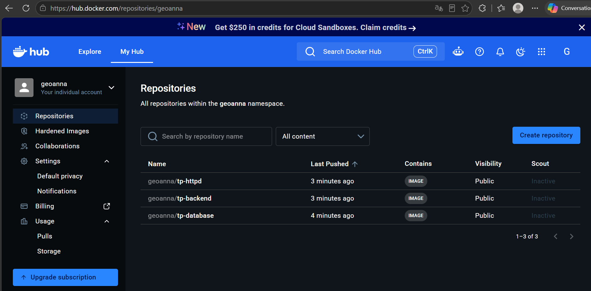

# TP Discover Docker : application 3-tiers

Application 3-tiers conteneurisée : serveur HTTP (Apache, reverse proxy), API backend (Spring Boot) et base de données (PostgreSQL), orchestrées avec Docker Compose.

## Structure du projet

```
tp-docker/
├── backend/
│   ├── Dockerfile
│   ├── pom.xml
│   └── src/
├── database/
│   ├── Dockerfile
│   ├── 01-CreateScheme.sql
│   └── 02-InsertData.sql
├── http-server/
│   ├── Dockerfile
│   └── httpd.conf
├── docs/                  # captures d'écran
├── .env.example
├── .gitignore
├── docker-compose.yml
└── README.md
```

Un dossier par image, comme demandé dans le TP.

## Lancer le projet

```bash
cp .env.example .env      # puis adapter les valeurs si besoin
docker compose up -d --build
```

Seul le serveur HTTP est exposé sur la machine hôte (port 8090). Le backend et la base ne sont joignables que via le réseau interne `app-network`.

- http://localhost:8090/departments
- http://localhost:8090/departments/IRC/students

### Résultats




---

## Réponses aux questions

### 1-1 Pourquoi utiliser `-e` plutôt que mettre les variables dans le Dockerfile ?

Une instruction `ENV` du Dockerfile est écrite dans les couches de l'image. Toute personne qui récupère l'image (ou le dépôt Git) peut lire le mot de passe avec `docker inspect` ou `docker history`, et l'image publiée sur Docker Hub le contiendrait aussi. Avec `-e` (ou `environment` / `env_file` dans Compose), les valeurs sont fournies au démarrage du conteneur seulement : l'image reste générique et sans secret, et on peut changer la configuration selon l'environnement (développement, test, production) sans reconstruire l'image. Dans ce projet, les valeurs sont dans un fichier `.env` ignoré par Git, avec un `.env.example` sans vrai secret.

### 1-2 Pourquoi attacher un volume au conteneur postgres ?

Le système de fichiers d'un conteneur est éphémère : quand le conteneur est supprimé, ses données disparaissent. Une base de données doit conserver ses données durablement. Le volume stocke `/var/lib/postgresql/data` en dehors du cycle de vie du conteneur : on peut supprimer, recréer ou mettre à jour le conteneur sans perdre les données. Il faut savoir que les scripts de `/docker-entrypoint-initdb.d` ne s'exécutent que si le répertoire de données est vide, donc au premier démarrage avec un volume neuf.

### 1-3 Conteneur de base de données : commandes et Dockerfile

`database/Dockerfile` :

```dockerfile
FROM postgres:17.2-alpine

COPY *.sql /docker-entrypoint-initdb.d/
```

Les scripts SQL sont exécutés par ordre alphabétique au premier démarrage : `01-CreateScheme.sql` (tables `departments` et `students`) puis `02-InsertData.sql` (données initiales).

Commandes (hors Compose) :

```bash
docker network create app-network
docker build -t tp-database ./database
docker run -d --name database --network app-network \
  -e POSTGRES_DB=db -e POSTGRES_USER=usr -e POSTGRES_PASSWORD=pwd \
  -v pgdata:/var/lib/postgresql/data \
  tp-database

# Adminer pour visualiser la base
docker run -d --name adminer --network app-network -p 8090:8080 adminer

# Vérifications
docker ps
docker logs database
docker exec -it database psql -U usr -d db -c "SELECT * FROM students;"
```

### 1-4 Pourquoi un multistage build ? Explication du Dockerfile

Un multistage build sépare la compilation de l'exécution. La compilation a besoin du JDK et de Maven (lourds), alors que l'exécution n'a besoin que d'un JRE. L'image finale ne contient donc que le JRE et le `.jar` : elle est plus légère, plus rapide à transférer et expose moins de surface d'attaque (pas de compilateur, pas de code source). Docker gère aussi la compilation, sans exiger Maven ni JDK sur la machine.

`backend/Dockerfile` :

```dockerfile
# Build stage
FROM eclipse-temurin:21-jdk-alpine AS myapp-build
ENV MYAPP_HOME=/opt/myapp
WORKDIR $MYAPP_HOME
RUN apk add --no-cache maven
COPY pom.xml .
COPY src ./src
RUN mvn package -DskipTests

# Run stage
FROM eclipse-temurin:21-jre-alpine
ENV MYAPP_HOME=/opt/myapp
WORKDIR $MYAPP_HOME
COPY --from=myapp-build $MYAPP_HOME/target/*.jar $MYAPP_HOME/myapp.jar
ENTRYPOINT ["java", "-jar", "myapp.jar"]
```

| Instruction | Rôle |
|---|---|
| `FROM eclipse-temurin:21-jdk-alpine AS myapp-build` | Image de build avec un JDK 21 (variante Alpine, légère). On nomme l'étape `myapp-build` pour la référencer plus tard. |
| `ENV MYAPP_HOME=/opt/myapp` | Définit une variable pour le répertoire de travail. |
| `WORKDIR $MYAPP_HOME` | Se place dans ce répertoire (créé s'il n'existe pas). |
| `RUN apk add --no-cache maven` | Installe Maven sans garder le cache du gestionnaire de paquets. |
| `COPY pom.xml .` | Copie le descripteur Maven. |
| `COPY src ./src` | Copie le code source. |
| `RUN mvn package -DskipTests` | Compile et produit le `.jar` dans `target/`, sans lancer les tests. |
| `FROM eclipse-temurin:21-jre-alpine` | Nouvelle image, qui ne contient qu'un JRE : tout ce qui précède est abandonné. |
| `COPY --from=myapp-build ... myapp.jar` | Récupère uniquement le `.jar` produit à l'étape de build. |
| `ENTRYPOINT ["java", "-jar", "myapp.jar"]` | Commande lancée au démarrage du conteneur. |

L'application se connecte à la base grâce à `application.yml` :

```yaml
spring:
  datasource:
    url: jdbc:postgresql://database:5432/db
```

L'hôte `database` est le nom du service Compose, résolu par le DNS du réseau Docker.

### 1-5 Pourquoi un reverse proxy ?

Le reverse proxy est l'unique point d'entrée de l'application. Il permet de :

- ne pas exposer le backend directement : seul Apache est publié, le backend reste sur le réseau interne ;
- centraliser le SSL/TLS (HTTPS) au même endroit ;
- répartir la charge entre plusieurs instances du backend ;
- servir des fichiers statiques ou un front-end, et gérer cache, compression, en-têtes de sécurité, journalisation ;
- changer ou déplacer le backend sans que les clients s'en aperçoivent.

`http-server/Dockerfile` :

```dockerfile
FROM httpd:2.4
COPY httpd.conf /usr/local/apache2/conf/httpd.conf
```

`httpd.conf` est la configuration par défaut récupérée dans le conteneur (`docker cp`), avec les modules `mod_proxy` et `mod_proxy_http` activés et ce bloc ajouté à la fin :

```apache
<VirtualHost *:80>
    ProxyPreserveHost On
    ProxyPass / http://backend:8080/
    ProxyPassReverse / http://backend:8080/
</VirtualHost>
```

### 1-6 Pourquoi docker-compose est-il important ?

Sans Compose, il faut taper à la main de longues commandes `docker build`, `docker run`, `docker network create`, dans le bon ordre, avec les bons paramètres. Compose décrit toute l'application dans un seul fichier versionné : services, réseaux, volumes, variables d'environnement, dépendances et politique de redémarrage. Une seule commande démarre, arrête ou reconstruit l'ensemble, de façon reproductible sur n'importe quelle machine. Le fichier sert aussi de documentation vivante de l'architecture.

### 1-7 Commandes docker-compose essentielles

| Commande | Rôle |
|---|---|
| `docker compose up -d` | Crée et démarre tous les services en arrière-plan |
| `docker compose up -d --build` | Idem, en reconstruisant les images |
| `docker compose build --no-cache` | Reconstruit les images sans utiliser le cache |
| `docker compose ps` | Liste l'état des services |
| `docker compose logs -f backend` | Suit les logs d'un service |
| `docker compose exec database psql -U usr -d db` | Ouvre une commande dans un conteneur en cours d'exécution |
| `docker compose stop` / `start` / `restart` | Arrête / démarre / redémarre les services |
| `docker compose down` | Arrête et supprime conteneurs et réseau |
| `docker compose down -v` | Idem, et supprime aussi les volumes (donc les données) |

### 1-8 Fichier docker-compose.yml

```yaml
services:
  database:
    build: ./database
    container_name: database
    networks:
      - app-network
    env_file: .env
    volumes:
      - db-data:/var/lib/postgresql/data
    restart: unless-stopped

  backend:
    build: ./backend
    container_name: backend
    networks:
      - app-network
    depends_on:
      - database
    restart: unless-stopped

  httpd:
    build: ./http-server
    container_name: http-server
    ports:
      - "8090:80"
    networks:
      - app-network
    depends_on:
      - backend
    restart: unless-stopped

networks:
  app-network:
    driver: bridge

volumes:
  db-data:
```

- **database** : construite depuis `./database`. Les variables `POSTGRES_*` viennent du fichier `.env` (pas de secret dans le Dockerfile). Le volume nommé `db-data` conserve les données. Aucun port n'est publié.
- **backend** : construite depuis `./backend`, démarre après la base (`depends_on`). Aucun port n'est publié : il n'est joignable que par le proxy.
- **httpd** : seul service exposé (`8090` sur l'hôte vers `80` dans le conteneur). Il dépend du backend.
- **networks** : un réseau bridge `app-network` partagé, sur lequel les services se joignent par leur nom (`database`, `backend`).
- **volumes** : déclare le volume nommé `db-data`.
- **restart: unless-stopped** : les conteneurs redémarrent après un crash ou un redémarrage de la machine, sauf arrêt manuel.

### 1-9 Publication sur Docker Hub

```bash
docker login

# Tag des images avec un numéro de version
docker tag tp-docker-database geoanna/tp-database:1.0
docker tag tp-docker-backend  geoanna/tp-backend:1.0
docker tag tp-docker-httpd    geoanna/tp-httpd:1.0

# Publication
docker push geoanna/tp-database:1.0
docker push geoanna/tp-backend:1.0
docker push geoanna/tp-httpd:1.0
```

Images publiées :

- https://hub.docker.com/r/geoanna/tp-database
- https://hub.docker.com/r/geoanna/tp-backend
- https://hub.docker.com/r/geoanna/tp-httpd



### 1-10 Pourquoi publier les images dans un dépôt en ligne ?

Un registre centralise les images et permet de les partager : les membres de l'équipe, les serveurs de test et de production, ou les outils d'intégration continue peuvent les récupérer avec `docker pull`, sans reconstruire à partir des sources. On y gère les versions (tags `1.0`, `1.1`, ...) pour déployer ou revenir en arrière de façon fiable, et on garantit que tout le monde exécute exactement la même image. Les entreprises utilisent souvent un registre privé auto-hébergé pour garder le contrôle de leurs images.